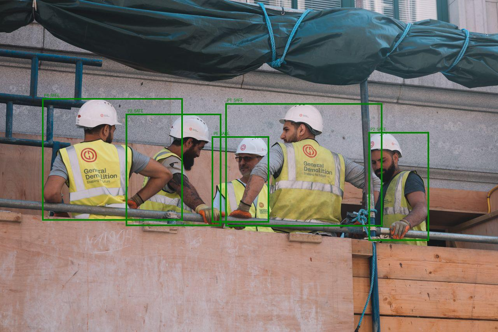
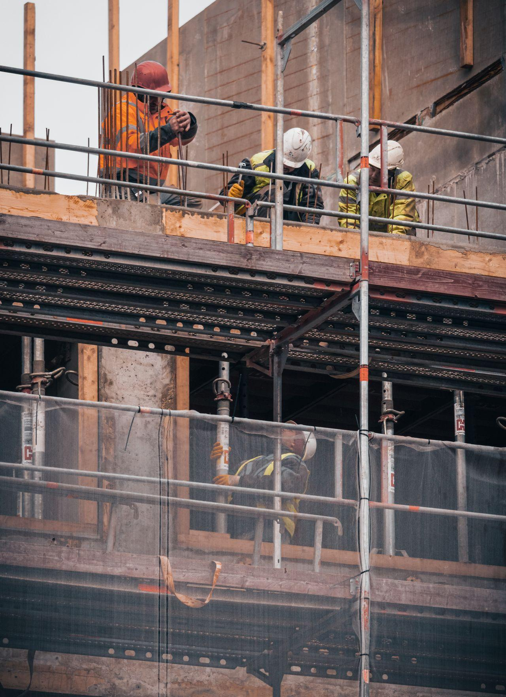
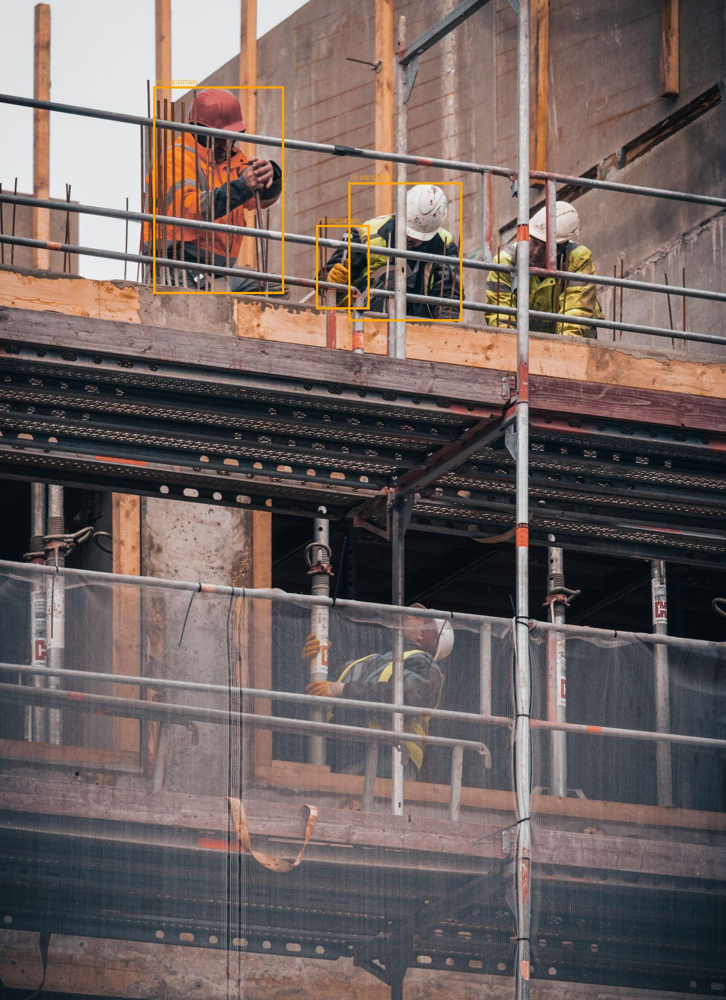

# Helmet & Safety Vest Detection (YOLOv8 + Streamlit)

A small computer-vision project: detect **helmets and safety vests** on construction / factory images and give a **Safe / Not safe verdict per person**.

Built end to end as a learning project: dataset selection, fine-tuning on free Colab GPU, evaluation on a held-out test set, error analysis on my own images, and a Streamlit demo.

> Only public data and open-source models are used. No company data or code.

## Problem
Workers on construction and industrial sites must wear a helmet and a high-visibility vest. Checking this by eye on camera footage does not scale. The goal: take an image, find each person, and say whether that person is wearing both.

## Approach
1. **Detector (fine-tuned):** YOLOv8n, starting from COCO weights, fine-tuned for 4 classes: `Helmet`, `No-Helmet`, `Vest`, `No-Vest`.
2. **Person detector (pretrained):** plain YOLOv8n (COCO) finds every *person*.
3. **Rule per person:** each PPE box is given to the person whose box contains the PPE box centre.
   - any `No-Helmet` / `No-Vest` -> **NOT SAFE**
   - `Helmet` and `Vest`, no `No-*` -> **SAFE**
   - anything else -> **UNCERTAIN** (the app says "not sure" instead of guessing)
4. **Streamlit app** with sliders for confidence and inference image size.

## Dataset
- Roboflow Universe, project **vest** by **OAKDev** (CC BY 4.0): https://universe.roboflow.com/oakdev/vest-pbrbu
- 1,359 images, 4 classes, exported in YOLOv8 format.
- Split: **959 train / 268 validation / 132 test** (about 70 / 20 / 10). 1 corrupt training image was skipped automatically.

## Training
| Setting | Value |
|---|---|
| Model | YOLOv8n (3.1M parameters), pretrained COCO weights |
| Epochs | 50 max, early stopping with patience 10 |
| Image size / batch | 640 / 16 |
| Hardware | Free Colab Tesla T4, about 13 minutes |
| Result | Early-stopped; best epoch 39 |

## Results (held-out test set, 132 images)
| Model | mAP50 | mAP50-95 | Precision | Recall | Inference |
|---|---|---|---|---|---|
| **YOLOv8n** (used in demo) | 0.718 | 0.405 | 0.74 | 0.69 | 5.8 ms |
| YOLOv8s | 0.725 | 0.397 | 0.82 | 0.67 | 10.0 ms |

Per class, YOLOv8n on the test set:

| Class | Precision | Recall | mAP50 |
|---|---|---|---|
| Helmet | 0.92 | 0.92 | 0.95 |
| No-Helmet | 0.71 | 0.81 | 0.77 |
| Vest | 0.89 | 0.62 | 0.76 |
| No-Vest | 0.45 | 0.43 | 0.40 |

Validation mAP50 was 0.79, higher than test (0.72), because the best epoch was chosen on the validation set. **The test numbers are the honest ones.** The test set is small (No-Vest has only 56 instances), so differences of a few points are within noise.

**Model size comparison:** YOLOv8s (3.5x more parameters) did not improve overall accuracy, so the limit is the **amount and variety of data**, not model capacity. I kept YOLOv8n because it is smaller, about twice as fast and equally accurate.

## Own test: 16 free stock photos (qualitative, not a benchmark)
I ran the full pipeline on 16 Pexels photos (in `samples/`) at two settings.

| | 640 px, person conf 0.40 | 1280 px, person conf 0.20 |
|---|---|---|
| People found | 26 | **42** |
| Images with nobody found | 4 | 3 |

A bigger inference size catches many more small / far-away people. I then looked at 6 result images by eye (12 people I could judge): **9 of 12 verdicts were right**. This is a tiny, hand-picked sample and should not be read as an accuracy figure.

| Example | What happened |
|---|---|
|  | 5 of 5 workers with helmet + vest: all SAFE. |
|   | Workers far away behind railings: nothing found at 640, 2 of 4 found at 1280. |

## Ground-truth evaluation of the final verdicts (39 hand-labelled photos)
Box metrics (mAP) do not say how good the final Safe / Not-safe answer is, so I labelled 39 stock photos by hand and compared. Labels are **counts per image** (how many people are fully equipped / not equipped / unsure), following `eval/LABELING_RULES.md` (hi-vis clothing counts as a vest, a cap is not a helmet). One crowd photo that could not be counted was removed. Run it with `python eval/run_eval.py`.

| Metric | 640 px, person conf 0.40 | 1280 px, person conf 0.20 |
|---|---|---|
| People found (recall) | 0.84 (94 of 103 predicted) | 0.98 |
| Extra people predicted | 7 | 31 |
| "Image contains an unsafe person": precision | 0.92 | 0.85 |
| Same, recall | 0.92 (22 of 24) | 0.92 |
| Image-level accuracy | 0.90 | 0.85 |
| False SAFE (SAFE said, not truly equipped) | 0 of 14 SAFE | 2 of 14 SAFE |
| Fully safe photos wrongly flagged NOT SAFE | 2 of 11 | 4 of 11 |

How to read this honestly:
- Only **39 images**; 22 of 24 has a wide 95% interval (about 0.74 to 0.98). Treat 0.92 as "around 0.9, not certain".
- The set is skewed: 24 of 39 photos contain an unsafe person. A system that always answers NOT SAFE would score 1.0 recall but only about 0.62 precision and accuracy.
- Ground truth is a **count**, not one box per person, so a NOT SAFE for the wrong person still counts as a hit. The numbers are somewhat optimistic.
- 16 of these photos are the ones I used earlier while choosing the settings (1280 px, person confidence 0.20), so the real performance on unseen photos is probably a bit lower.
- Part of the "extra people" count may be small background people I did not label.
- The app is cautious: it said SAFE for only 14 people, while 42 people were truly fully equipped. It is weak at confirming safety and often answers UNCERTAIN.
- Trade-off: 1280 px finds more people (0.84 to 0.98) but adds false alarms and 2 false SAFE verdicts, so 640 px is the default.

## Limitations (what fails, and why)
- **Colour looks like a vest.** A worker with an orange hood and no vest was marked SAFE (`docs/error_orange_hood_as_vest.jpg`). A bright logo with no person was first detected as "Vest" (fixed by requiring a person box).
- **Overlapping people.** Two workers standing next to each other, both fully equipped: one was marked NOT SAFE (`docs/error_false_not_safe.jpg`). Assigning PPE by box centre is a simple rule and can mix up neighbours.
- **Small / far / hidden people.** Misses are common behind railings or when the person is a few dozen pixels tall. Higher inference size helps but is slower.
- **Low light.** In a dark stairwell, a worker with helmet and vest was marked NOT SAFE (`docs/lowlight_mixed.jpg`).
- **Verdicts change with settings.** The same person can flip between SAFE and NOT SAFE when the image size changes (for example `8961260.jpg` and `33914927.jpg`). This is not reliable enough for real safety use.
- **False people.** At person confidence 0.20 a fan was detected as a person (`docs/factory_context_fan_false_person.jpg`).
- **Context.** The rule assumes helmet + vest everywhere. In a textile factory, workers without helmets are marked NOT SAFE although helmets may not be required there.
- **No-Vest is the weakest class** (test mAP50 0.40). The dataset is small (1,359 images from 2023) and a missing vest is an *absence*, which is harder to learn.

## Possible next steps
- More and more varied data (night, far cameras, different helmet types), and class balancing for `No-Vest`.
- Assign PPE to a person by body region (head for helmet, torso for vest) instead of box centre.
- Evaluate the final verdict against hand-labelled ground truth, not only box metrics.
- Video / webcam mode with tracking, so one person gets one stable verdict.

## Run the demo
```bash
pip install -r requirements.txt
streamlit run app.py
```
The first run downloads the COCO `yolov8n.pt` person model automatically. Use the sidebar to pick an inference size (640 / 960 / 1280) and confidence thresholds, and upload an image or pick one from `samples/`.

## Tests
The Safe / Not-safe rule lives in `verdict.py` (pure Python, no model needed) and has 19 unit tests in `tests/` covering the rule, the box-assignment geometry and the image-level summary. They run on every push through GitHub Actions.
```bash
python -m unittest discover -s tests -v
```
The tests check the *rule*, not the model. Model quality is measured by the metrics above.

## Repo layout
```
app.py              Streamlit demo
verdict.py          Safe / Not-safe logic (unit tested)
tests/              unit tests (run in CI)
.github/workflows/  CI configuration
models/best_n.pt    fine-tuned YOLOv8n weights
samples/            16 free Pexels photos for the demo
docs/               result screenshots used in this README
requirements.txt
```

## Credits
- Dataset: "vest" by OAKDev, Roboflow Universe, CC BY 4.0.
- Sample photos: Pexels (free to use under the Pexels License).
- Model: Ultralytics YOLOv8 (AGPL-3.0).
